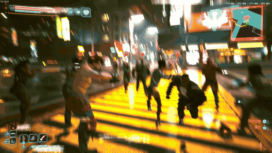

# Night City Lottery

A small experimental Cyberpunk 2077 CET mod: roll a temporary combat companion, bring a four-person friendly squad, or stage a street fight with up to **8 NPCs per side**.

[Download v0.2.0](https://github.com/longsizhuo/night-city-lottery/releases/tag/v0.2.0) · [中文教程](docs/INSTALL.zh-CN.md)



## Installation

Tested on **Windows PC, game patch 2.5**, with CET 1.38.1, RED4ext 1.31.0, Codeware 1.21.2 and redscript 0.5.32. Links to the original dependency releases are in the [main README](README.md).

Install the dependencies following their authors' instructions. Exit the game, then merge the `bin` directory from **NightCityLottery-0.2.0.zip** into your game root. The final path must be:

```text
bin/x64/plugins/cyber_engine_tweaks/mods/NightCityLottery/init.lua
```

Load a save and open the CET overlay. Under **Bindings**, assign this mod's hotkeys. Suggested keys are **F6** to draw/reroll, **F7** to recall, **F8** to dismiss and clear owned actors. These keys are not assigned automatically.

Drawing and recalling require being out of combat. The panel also offers four friendly reinforcements, 4v4 and 6v6 battles. For 8v8, use the CET console in a loaded, open street scene:

```lua
GetMod("NightCityLottery").battle(8)
```

## Limitations

- Companions are temporary. Dismiss before story scenes; draw again after loading a save.
- Reroll cooldown is 10 seconds. Recall does not revive a dead companion.
- The pool has 10 ordinary combat configurations, not story characters or bosses.
- Filming immortality is **off by default**. Leave it off for normal-health combat.
- Vehicles, elevators and complex indoor navigation are not fully tested.
- One roughly six-hour local session ended in an engine integer-overflow crash. Its cause remains unconfirmed. This is an **experimental prerelease**, not a claim of long-session stability. See [testing notes](docs/TESTING.md).
- Self-imposed challenges such as one draw per encounter are suggestions, not enforced rules.

Use F8 to clear actors, exit the game, and remove only the `NightCityLottery` mod folder to uninstall. Dependencies are downloaded separately and are not bundled.

## Development and license

```sh
python -m pip install -r requirements-dev.txt
python -m unittest discover -s tests -v
python scripts/package.py --output dist
```

Code is MIT-licensed. Follower API usage is based on the MIT-licensed WolvenKit CET examples; the notice is preserved. Game assets and screenshots retain their respective owners' rights. No music, voice samples, game saves or local installer are shipped.
