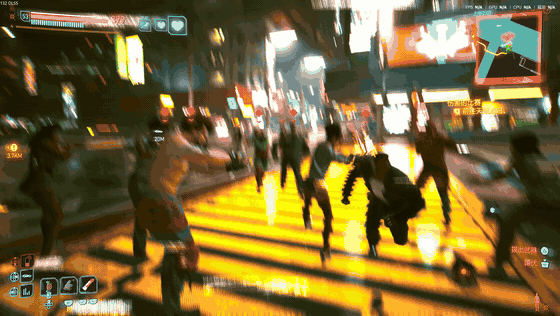

# Night City Lottery · 夜之城随机队友

一个人逛夜之城怪无聊的，所以写了个随机队友 MOD。

随机摇一个临时搭子，一起逛街、一起打架。也可以拉起四人小队，或者安排一场最多 **8 对 8** 的街头混战。

**实验预发布 v0.2.0** · Windows PC · 本地实测游戏版本 **2.5**

[下载安装包](https://github.com/longsizhuo/night-city-lottery/releases/tag/v0.2.0) · [安装与使用教程](docs/INSTALL.zh-CN.md) · [玩法与常见问题](docs/GUIDE.zh-CN.md) · [English](README.en.md)



## 能做什么

| 功能 | 当前行为 |
| --- | --- |
| 随机抽队友 | 从 10 种普通战斗配置中抽取一名临时队友，含拳手、近战手和多种枪手 |
| 跟随与战斗 | 跟随玩家，协助战斗；队友会受伤，也可能阵亡 |
| 召回 | 脱战后把当前随机队友召回身边 |
| 四人增援 | 面板生成 4 名友军，不额外生成敌人 |
| 多人混战 | 面板支持 4 对 4、6 对 6；CET 控制台接口最多 8 对 8 |
| 清场 | 清理本 MOD 生成的队友、演示小队及其尸体 |

队友临时生成，不写入持久生成状态；读档后需要重新抽取。默认候选池不包含剧情角色或 Boss。

## 三分钟上手

1. 退出游戏，安装下表中的依赖。
2. 从 [v0.2.0 Release](https://github.com/longsizhuo/night-city-lottery/releases/tag/v0.2.0) 下载 **NightCityLottery-0.2.0.zip**，把里面的 `bin` 目录合并到游戏根目录。
3. 启动游戏、进入自由探索，按你设置的 CET 开关键打开面板。
4. 到 CET 的 **Bindings** 中给本 MOD 绑定快捷键：推荐 `F6` 抽取、`F7` 召回、`F8` 清场。
5. 脱离战斗后按 `F6`，等 NPC 加载完成，再带着它行动。

**F6 / F7 / F8 是推荐绑定，不会自动覆盖你现有的键位。** 也可以直接用模组面板按钮。

### 已实测的依赖组合

| 组件 | 实测版本 | 原作者下载 |
| --- | --- | --- |
| Cyberpunk 2077 | 2.5 / Windows | 游戏本体 |
| Cyber Engine Tweaks | 1.38.1 | [CET](https://github.com/maximegmd/CyberEngineTweaks/releases/tag/v1.38.1) |
| RED4ext | 1.31.0 | [RED4ext](https://github.com/WopsS/RED4ext/releases/tag/v1.31.0) |
| Codeware | 1.21.2 | [Codeware](https://github.com/psiberx/cp2077-codeware/releases/tag/v1.21.2) |
| redscript | 0.5.32 | [redscript](https://github.com/jac3km4/redscript/releases/tag/v0.5.32) |

发布包仅含本 MOD。依赖请按原作者说明安装；不要将这组版本当作其他游戏补丁的兼容承诺。

## 可以怎么玩

- **随机搭子**：抽到谁，就带谁逛街、处理街头遭遇。
- **一抽到底**：自己约定一场遭遇只抽一次，中途不重抽。这个限制由玩家自定，MOD 不会自动锁住重抽。
- **小队出门**：用“战斗增援：我方 4 人”带一支临时小队。
- **街头混战**：选开阔地，生成双方小队后一起参战。先确认“拍摄续航”没有勾选，才能保持普通血量。

## 当前边界

- 抽取、重抽和召回要求脱战；演示小队可以用于战斗中的增援，但仍会检查剧情和载具状态。
- 重抽冷却 10 秒；阵亡队友不会被召回复活。
- 剧情演出前请解散。载具、电梯和复杂室内寻路尚未完整验证。
- “拍摄续航”默认关闭；开启后仅保护本次生成的演示 NPC，不保护玩家。
- **有一次本地约 6 小时会话结束时发生引擎整数溢出崩溃，原因未确认。** 首版因此标为实验预发布。短时实测不代表长期稳定；混战结束后可清理临时小队。

详细记录见 [测试与已知问题](docs/TESTING.md)。

## 开发

```sh
python -m pip install -r requirements-dev.txt
python -m unittest discover -s tests -v
python scripts/package.py --output dist
```

测试使用模拟引擎和 LuaJIT 2.1，不会连接游戏或操作存档。安装包构建会核对文件白名单并输出 SHA256 校验文件。

## 许可与致谢

本项目代码采用 [MIT License](LICENSE)。跟随角色的 API 用法参考了 [WolvenKit/cet-examples](https://github.com/WolvenKit/cet-examples)，保留其 [MIT 声明](mod/NightCityLottery/THIRD_PARTY.txt)。

游戏、角色和截图属于其相应权利人；代码许可不涵盖 Cyberpunk 2077 的游戏素材。依赖、音乐、声音克隆资源、个人存档和本机安装器均不包含在此仓库或模组发布包中。
